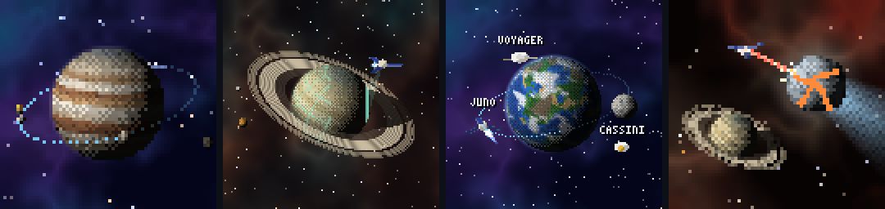
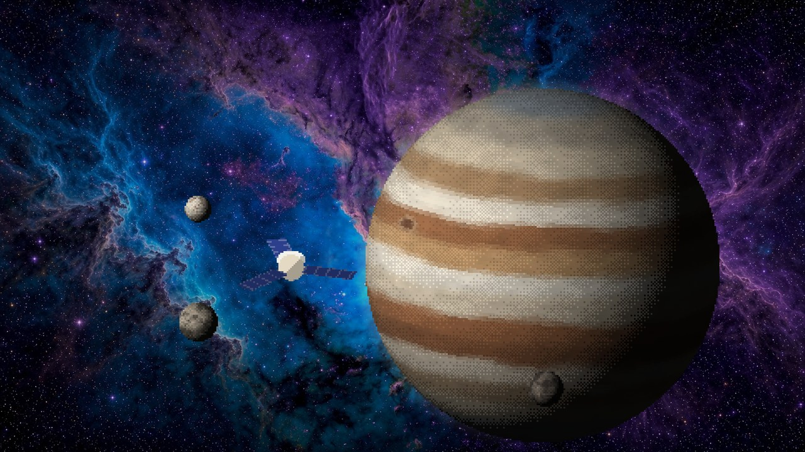

# space_mods

Space for Claude Code, in pixels. Every planet, moon, ring, spacecraft and
star here is drawn in code a pixel at a time: no textures, no photos, no
recordings.



## pixel-probe

A probe orbiting a world while Claude works. It is a Claude Code mod of
function hooks, the back end of what mc-rice's dashboard (`claude_mods/mc-rice`)
draws in Steve's place once `/steve off` and `/probe on` give it the place
(`hooks/mirror.ts`, mc-rice's `tools/probe-frames.ts`). Nothing is drawn
beside the chat: with no dashboard round the shell, the probe shows nowhere.

**The effort level picks the world.** The harder Claude thinks, the bigger the
world, each with its own moons:

| effort | world | moons |
| --- | --- | --- |
| low | the Moon | |
| medium | Mars | Phobos, Deimos |
| high | Earth | the Moon |
| xhigh | Saturn, rings and all | Enceladus, Titan |
| max | Jupiter, its Great Red Spot turning | Io, Europa, Ganymede, Callisto |
| a thinking budget | Neptune | Triton |
| no effort setting | Pluto | Charon |

**The permission mode picks the scene**, and Claude's work fills it in, by
requests and tool calls, or by its task list where it keeps one:

- **orbit** (the usual modes): the probe charts its orbit as Claude works; when
  Claude stops the orbit closes and the probe signals home.
- **survey** (plan mode): a beam sweeps the world and the map grows across it;
  done, the whole map flashes.
- **asteroid** (auto mode): the probe lasers an asteroid, which cracks as Claude
  works and shatters when Claude stops. Tougher with more effort: a stony
  asteroid at low, a comet at xhigh, a metal one at max.
- **apollo** (`/probe apollo`): Apollo 11, over black and the stars, with the
  real Earth and Moon lit as they were in July 1969. Each turn the Saturn V
  lifts off from pad 39A, drops its stages, makes Earth orbit and burns for the
  Moon, and Columbia turns round to dock with Eagle. The coast out goes as far
  as the turn has got, and when Claude stops, Apollo goes behind the Moon into
  lunar orbit. A `git commit` (or `gh pr create`) lands Eagle at Tranquility
  Base; a `git push` (or a merge) puts Neil on the ladder, then the Moon, Buzz
  after him, and the flag up. A turn that lands Eagle and no more goes on from
  the Moon next turn; any other turn without a commit or a push starts over at
  the pad. Once the flag is up, drag over the picture (or scroll out) to pull
  back from the flag to the landing site seen from a distance, with Earth
  hanging small and blue above it, 66.5° up as it did; right-click to go back
  in.

**Every agent flies a craft of its own**, after a real mission (Voyager,
Cassini, Rosetta, Dawn, New Horizons...): it flies in when the agent starts,
orbits beside the probe, lasers the asteroid with it, and fires its engine and
flies off when the agent is done.

Drag over the picture to spin the world and tip it toward you; scroll to zoom
about the pointer; right-click to put it back.

| `/probe ...` | |
| --- | --- |
| `on`, `off` | the probe in the dashboard's place, or off it, kept across sessions |
| `orbit`, `survey`, `asteroid`, `apollo`, `follow` | keep a scene whatever the mode, or follow the mode again |
| `jupiter`, `saturn`, ... `effort` | keep a world whatever the effort, or let the effort pick again |
| `juno`, `voyager`, `cassini`, ... | the craft Claude flies (Juno unless asked) |
| `labels on`, `labels off` | names over the craft, where the picture is fine enough |
| `sound on`, `sound off` | blips, chirps, a laser and a boom; off until asked for |

### Install

At the prompt of a terminal session:

```
/plugin install pixel-probe --marketplace jacobwillgolden-svg/space_mods
```

Answer `y` to add the marketplace, then pick a scope. From a shell, the same is
`claude plugin install pixel-probe --marketplace jacobwillgolden-svg/space_mods`. In the
desktop app, where `/plugin` does not run: click + next to the prompt box,
then Plugins, Add marketplace with `jacobwillgolden-svg/space_mods`, then Add plugin.

To run it from a clone instead: `claude --plugin-dir ./pixel-probe`, or name
the folder in `CLAUDE_CODE_PLUGIN_DIRS`.

## Wallpapers



The same worlds as a desktop or terminal wallpaper: the mod's own renderer
draws a world, its moons and the probe in big square pixels, laid over one of
the panoramas.

```
python tools/wallpaper.py jupiter
python tools/wallpaper.py saturn --panorama orion --size 2560x1440 --pixel 5
python tools/wallpaper.py --all
```

They land in `wallpapers/`. It needs Node 23.6 or newer (to run the mod's
TypeScript as it is) and Pillow. In kitty, `background_image` in kitty.conf,
or `kitten @ set-background-image` for the window you are in.

## Panoramas

`panoramas/` holds three nebulae, and each scene's sky is drawn in
one's colors:

- `violet.jpg`: blue and violet, behind the orbit
- `orion.jpg`: rose, ember and teal, behind the survey
- `ember.jpg`: red and gold, behind the asteroid

## Making and checking

- `python pixel-probe/tools/sounds.py` synthesizes the clips in
  `pixel-probe/sounds/` (numpy).
- `claude plugin validate pixel-probe` and `claude plugin test pixel-probe`
  check the mod.

## License

MIT, for the code, the clips and the pictures in `docs/`. The panoramas were
made with Grok's image generator. The craft are named after real missions and
drawn as simple shapes; none of their agencies' artwork is used. Apollo 11's
Earth is filled in from Natural Earth's 1:110m land outlines, which are in the
public domain; its Moon's seas are traced from the albedo map of NASA's Lunar
Reconnaissance Orbiter, also in the public domain, and its craters are placed
by their coordinates or spread as the Moon's are.
